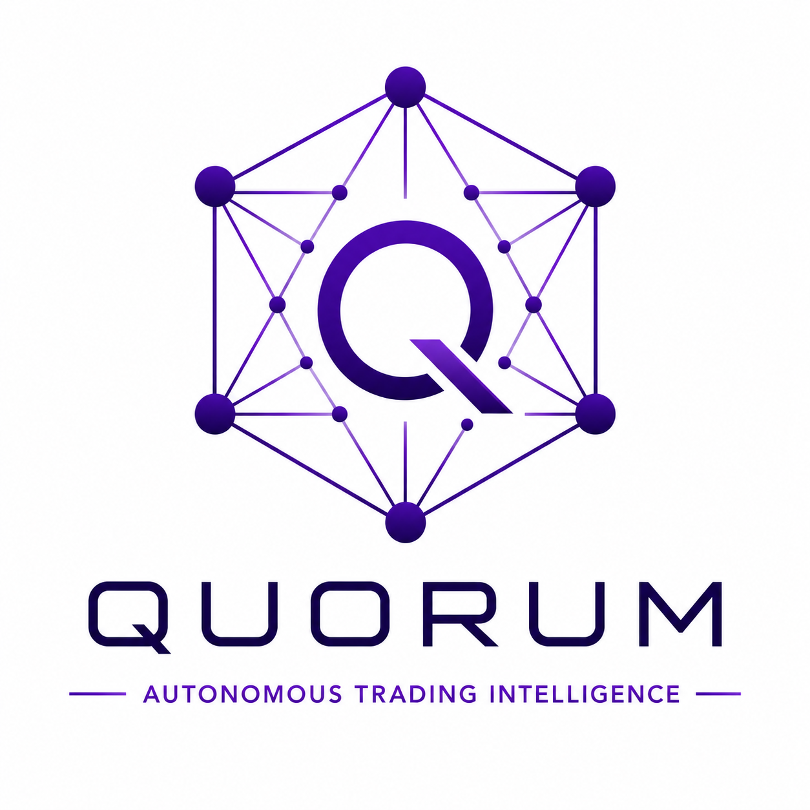
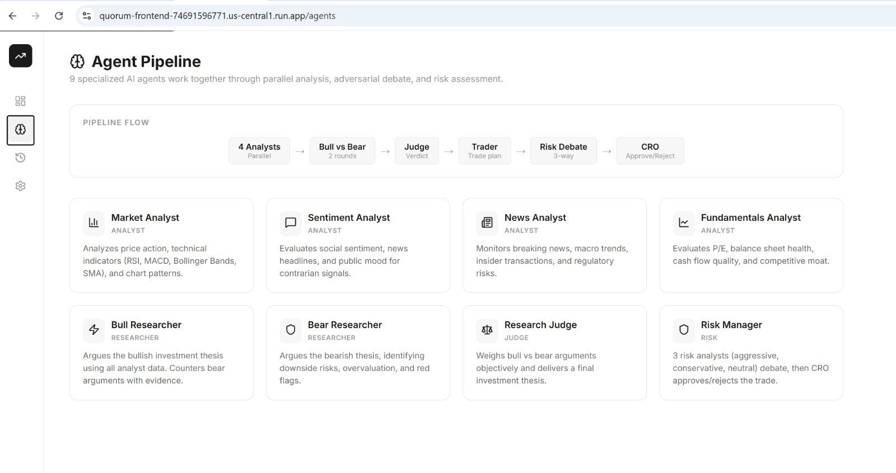
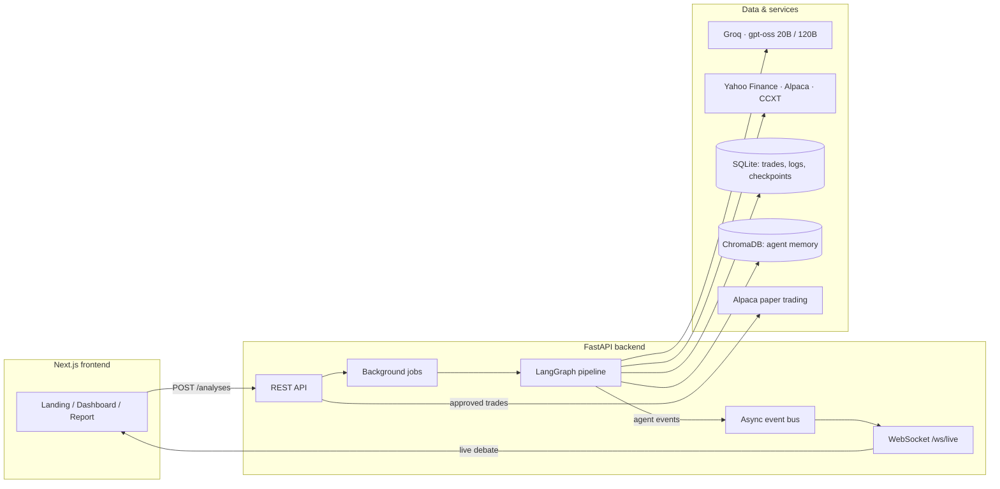
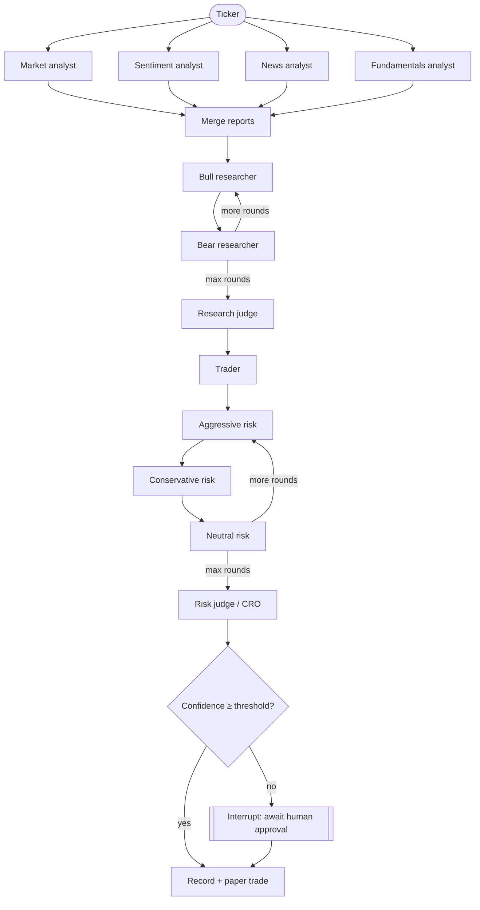
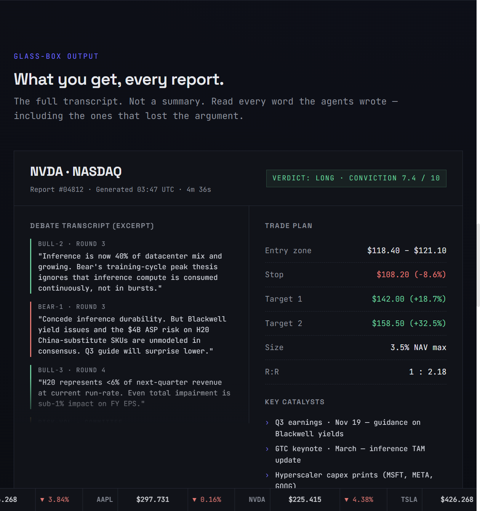
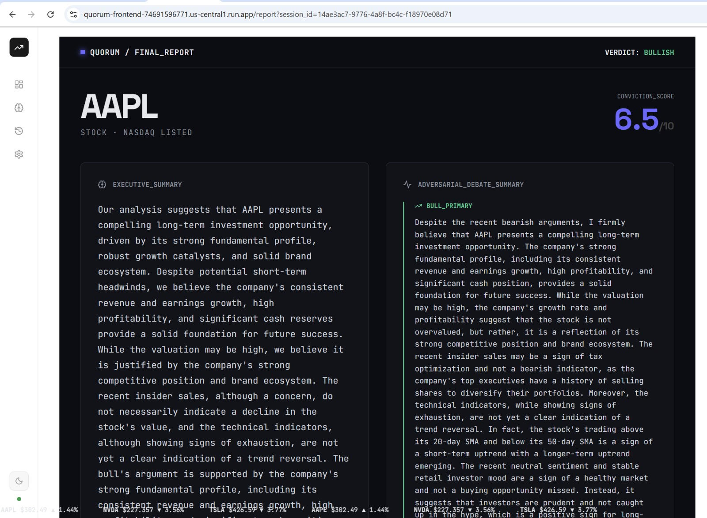

<p align="center">
  
</p>

<h1 align="center">Quorum</h1>

<p align="center">
  <strong>A multi-agent LLM research desk that debates every trade before it happens.</strong>
</p>

<p align="center">
  <a href="https://github.com/nishnarudkar/Quorum---Multi-Agent-LLM-Trading-Framework/actions/workflows/ci.yml"></a>
  
  
  
  
</p>

<p align="center">
  <a href="https://quorum-frontend-74691596771.us-central1.run.app">Live demo</a> ·
  <a href="https://quorum-backend-74691596771.us-central1.run.app/docs">API docs</a> ·
  <a href="docs/API_REFERENCE.md">API reference</a> ·
  <a href="docs/DEPLOY_RENDER.md">Deploy on Render</a>
</p>

---

Quorum runs twelve specialised LLM agents over a stock or crypto asset. Analysts gather market data, technicals, news, sentiment and fundamentals in parallel. Bull and bear researchers then argue over several rounds, and a judge weighs the transcript. A trader drafts a plan, and a three-member risk committee stress-tests it before a chief risk officer signs off. Low-confidence trades pause for a human to approve before anything is sent to an Alpaca **paper-trading** account.

The point is a **glass box**: instead of an opaque score, you see every argument, rebuttal and dissent, streamed live over WebSockets as the agents work.



## Highlights

- **Stateful agent graph.** Built on LangGraph, with parallel analyst fan-out (`Send`), conditional debate loops, and SQLite checkpointing that lets a paused run resume later.
- **Human-in-the-loop.** Trades below a confidence threshold call LangGraph's `interrupt()`. The graph stays suspended until `POST /trades/{thread_id}/approve` resumes it.
- **Live streaming.** An async event bus pushes per-agent progress to every connected client over WebSockets. Long runs execute as background jobs you can poll by ID.
- **Resilient LLM layer.** Rotates Groq API keys, backs off on rate limits, enforces per-call and per-pipeline timeouts, caps concurrent calls with a semaphore, and parses malformed JSON from model output.
- **Agent memory.** ChromaDB stores past situations and outcomes, and researchers recall similar cases before arguing.
- **Real data, paper execution.** Market data comes from Yahoo Finance, Alpaca and CCXT. Approved signals become sized Alpaca paper orders with P&L tracking.
- **Watchlist automation.** An opt-in scheduler re-analyses a watchlist on an interval and can send alerts to Telegram or Discord.
- **Tested and CI'd.** A pytest suite covers graph routing, HITL decisions, retry logic and the HTTP API. GitHub Actions also lints, typechecks and builds the frontend.

## Architecture



### The agent pipeline



| Stage | Agents | Model | Output |
|:--|:--|:--|:--|
| Analysis | Market, Sentiment, News, Fundamentals (parallel) | gpt-oss-20b | Structured reports: sentiment, confidence, key findings |
| Research debate | Bull ↔ Bear (multi-round), Research judge | 20B debaters, **120B judge** | Verdict, confidence, investment thesis |
| Trade plan | Trader | gpt-oss-20b | Action, entry, target, stop, position size |
| Risk committee | Aggressive ↔ Conservative ↔ Neutral, Risk judge | 20B debaters, **120B judge** | Approved or rejected plan with adjusted sizing |
| Approval | Human (when confidence < `AUTO_TRADE_CONFIDENCE`) | — | Approve or reject via API or UI |

## Screenshots

| Final report | Report detail |
|:--:|:--:|
|  |  |

## Tech stack

| Layer | Technologies |
|:--|:--|
| Agents | LangGraph, LangChain, Groq (gpt-oss-120b, gpt-oss-20b) |
| Backend | Python 3.11, FastAPI, asyncio, WebSockets, Pydantic v2 |
| Data | yfinance, Alpaca, CCXT, stockstats |
| Storage | SQLite (aiosqlite) for trades, logs and checkpoints; ChromaDB for vector memory |
| Frontend | Next.js 16, React 19, TypeScript, Framer Motion, Lightweight Charts, Three.js |
| Ops | Docker, Google Cloud Run, GitHub Actions |

## Getting started

### Prerequisites

- Python 3.11+
- Node.js 20+
- A free [Groq API key](https://console.groq.com)
- Optional: [Alpaca](https://alpaca.markets) paper-trading keys, for live prices and order execution

### Backend

```bash
cd backend
python -m venv venv
source venv/bin/activate        # Windows: venv\Scripts\activate
pip install -r requirements-dev.txt
cp .env.example .env            # then add your GROQ_API_KEY
python -m uvicorn api.main:app --reload
```

The API runs at `http://localhost:8000`, with interactive docs at `/docs`.

### Frontend

```bash
cd frontend
npm install
npm run dev
```

Open `http://localhost:3000` and click **Run an analysis**. You can also use the dashboard at `/dashboard`.

### Try it from the command line

```bash
# Start a background analysis
curl -X POST localhost:8000/analyses -H "Content-Type: application/json" \
     -d '{"ticker": "NVDA", "asset_type": "stock"}'

# Poll for the result
curl localhost:8000/analyses/<analysis_id>
```

## Configuration

All settings live in `backend/.env` (see [`.env.example`](backend/.env.example)). The most important ones:

| Variable | Default | Purpose |
|:--|:--|:--|
| `GROQ_API_KEY` / `GROQ_API_KEYS` | — | One key, or several separated by `;` for rotation |
| `DEEP_THINK_MODEL` / `QUICK_THINK_MODEL` | `openai/gpt-oss-120b` / `openai/gpt-oss-20b` | Models for judges and for other agents |
| `MAX_DEBATE_ROUNDS` / `MAX_RISK_DEBATE_ROUNDS` | `2` / `2` | Debate depth |
| `AUTO_TRADE_CONFIDENCE` | `0.85` | Trades below this pause for human approval |
| `ENABLE_HITL` | `true` | Turn human-in-the-loop off to auto-approve everything |
| `ALPACA_API_KEY` / `ALPACA_SECRET_KEY` | — | Market data and paper-order execution |
| `LLM_CONCURRENCY` | `2` | Concurrent LLM calls per API key |
| `PIPELINE_TIMEOUT` | `600` | Seconds before a run is aborted |
| `SCANNER_ENABLED` | `false` | Re-analyse the watchlist every `SCAN_INTERVAL_MINUTES` |

## Testing

```bash
cd backend
python -m pytest
```

The tests run offline. They use a fake pipeline and fake LLM clients, so no API keys are needed. CI runs these tests plus `eslint`, `tsc` and `next build` on every push.

## Deployment

Quorum can be deployed directly to [Render](https://render.com) using the included [`render.yaml`](render.yaml) Blueprint or as standalone Web Services. See the full step-by-step guide in [docs/DEPLOY_RENDER.md](docs/DEPLOY_RENDER.md).

## Project structure

```
backend/
├── agents/          # Analysts, bull/bear researchers, trader, risk committee
├── graph/           # LangGraph pipeline: routing, HITL, checkpointing
├── api/             # FastAPI app: REST, WebSocket, background jobs
├── data/            # Yahoo Finance, Alpaca and CCXT providers, ticker search
├── memory/          # SQLite trade DB, ChromaDB vector memory
├── realtime/        # Price stream and scheduled watchlist scanner
├── utils/           # Event bus, JSON repair, alerts, serialization
├── llm_client.py    # Rate-limited Groq client with key rotation
└── tests/           # pytest suite
frontend/
├── app/             # Landing, dashboard, live report, trades, agents, settings
└── components/      # Charts, approval modal, run-analysis modal, ticker tape
```

## Limitations and roadmap

- **No authentication.** Every endpoint is open, including trade approval. Add an auth layer before exposing trading publicly.
- **Single-instance state.** Background-job status lives in memory, and SQLite/Chroma use the local disk. Moving to Postgres and a job queue would allow horizontal scaling.
- **No backtesting yet.** A historical evaluation harness that scores agent accuracy over past dates is the next major feature.

## Disclaimer

Quorum is a research and engineering project. It is **not financial advice**. Trade execution targets Alpaca paper accounts only.

## License

[MIT](LICENSE)
